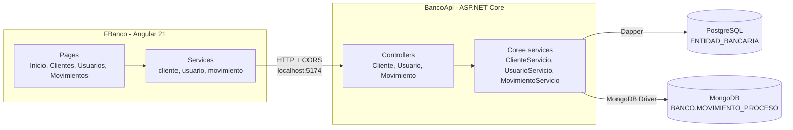
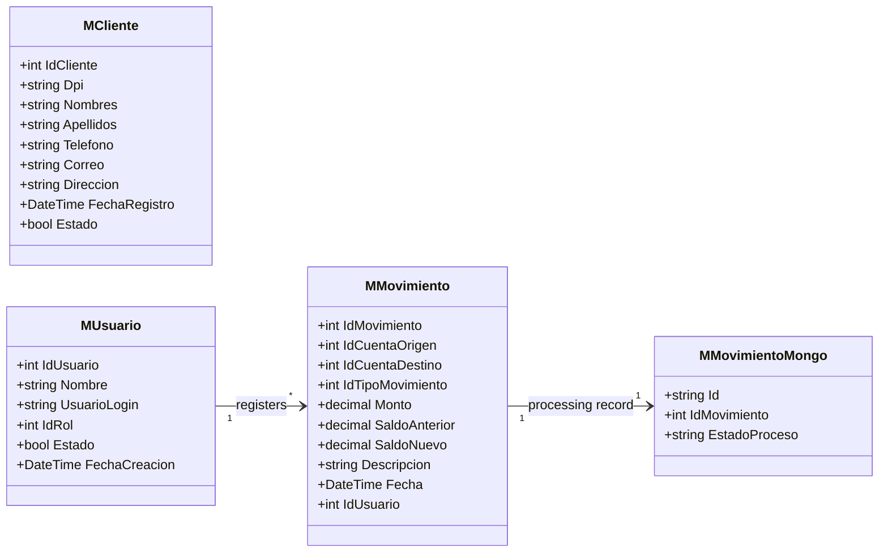

<div align="center">

# BancoAPI

**A banking system with an ASP.NET Core REST API and an Angular web client to manage clients, users and account movements.**


</div>

---

## Table of Contents

- [About](#about)
- [At a Glance](#at-a-glance)
- [Features](#features)
- [Concepts Applied](#concepts-applied)
- [Architecture](#architecture)
- [Data Model](#data-model)
- [Endpoints](#endpoints)
- [How to Run](#how-to-run)
- [Example Requests](#example-requests)
- [Project Structure](#project-structure)
- [Requirements](#requirements)
- [Tech Stack](#tech-stack)

---

## About

This project was developed for the **Mobile App Development** course of my **Systems Engineering** degree. It is a small banking system made of two parts:

- **Back end (`BancoApi`):** an ASP.NET Core REST API that manages bank clients, system users and account movements, storing the data in **PostgreSQL** and the processing status of each movement in **MongoDB**.
- **Front end (`FBanco`):** an Angular web application that consumes the API.

It is the most complete project of the course, because it connects a client application to its own back end.

> [!NOTE]
> The interface and the API's response messages are in Spanish. The texts in this document are shown translated into English. JSON property names are kept as they appear in the code.

---

## At a Glance

| | |
|---|---|
| **Type** | REST API and web client |
| **Back end** | ASP.NET Core (.NET 9), Dapper, Npgsql, MongoDB .NET Driver |
| **Front end** | Angular 21 with server-side rendering support |
| **Databases** | PostgreSQL (`ENTIDAD_BANCARIA`) and MongoDB (`BANCO.MOVIMIENTO_PROCESO`) |
| **Difficulty** | ★★★ |
| **Key concepts** | Full-stack integration, CORS, layered architecture, two databases |

---

## Features

**API**

- **Clients:** list, get by ID, register and update. DPI, first names and last names are required.
- **Users:** list of the system users with their role and status.
- **Movements:** register an account movement (source account, optional destination account, movement type, amount, balances, description and user). Each movement is stored in PostgreSQL and a processing record with status `PENDIENTE` (pending) is created in MongoDB.
- **CORS** enabled for the Angular client on ports 4200 and 4000.
- **Interactive documentation** with OpenAPI and Swagger UI in development.

**Web client (FBanco)**

- **Home** page of the *Banking System*.
- **Clients** page: client list and a form to register and edit clients.
- **Users** page: list of system users.
- **Movements** page: form to register a movement.

---

## Concepts Applied

- **Layered architecture:** `BancoApi` (controllers), `Coree` (interfaces and services) and `Modelo` (entities).
- **Dependency injection:** `IUsuario`, `ICliente` and `IMovimiento` registered with their services; `NpgsqlDataSource` and `IMongoClient` as singletons.
- **Dapper:** parameterized SQL queries for the `cliente`, `usuario` and `movimientos` tables.
- **Two databases:** relational data in PostgreSQL and a processing record per movement in MongoDB.
- **CORS policy:** `AddCors` with the front end's allowed origins.
- **Environment-specific behavior:** Swagger only in development, and HTTPS redirection only outside development.
- **Angular services:** one service per resource (`cliente`, `usuario`, `movimiento`) using `HttpClient` and typed models.
- **Angular routing:** routes for home, clients, users and movements.

---

## Architecture



---

## Data Model



---

## Endpoints

| Method | Route | Description |
|---|---|---|
| `GET` | `/api/Cliente/ObtenerTodos` | Lists all clients |
| `GET` | `/api/Cliente/{id}` | Gets a client by ID |
| `POST` | `/api/Cliente/Ingresar` | Registers a client |
| `PUT` | `/api/Cliente/{id}` | Updates a client |
| `GET` | `/api/Usuario/ObtenerTodos` | Lists all users |
| `POST` | `/api/Movimiento` | Registers a movement (PostgreSQL and MongoDB) |

---

## How to Run

**1. Prepare the databases**

- PostgreSQL: a database named `ENTIDAD_BANCARIA` with the `cliente`, `usuario` and `movimientos` tables.
- MongoDB running on `localhost:27017`. The `BANCO` database and the `MOVIMIENTO_PROCESO` collection are created on the first insert.

**2. Configure the connection** in `BancoApi/appsettings.json` by replacing `YOUR_PASSWORD` with your PostgreSQL password.

**3. Run the API** (terminal 1):

```bash
cd BancoAPI
dotnet run --project BancoApi
```

The API listens on `http://localhost:5174`. Open `http://localhost:5174/swagger` to test the endpoints.

**4. Run the web client** (terminal 2):

```bash
cd BancoAPI/FBanco
npm install
npm start
```

Open `http://localhost:4200/` in your browser.

> [!TIP]
> Start the API before the web client: FBanco sends its requests to `http://localhost:5174`.

---

## Example Requests

<details>
<summary>Show request and response examples</summary>

**`POST /api/Cliente/Ingresar`**

```json
{
  "dpi": "1234567890101",
  "nombres": "Alexander",
  "apellidos": "Oliva",
  "telefono": "55551234",
  "correo": "alexander@example.com",
  "direccion": "Zone 1, Guatemala City",
  "estado": true
}
```

**Missing DPI (`400 Bad Request`):**

```json
{ "mensaje": "The DPI is required." }
```

**`POST /api/Movimiento`**

```json
{
  "idCuentaOrigen": 1,
  "idCuentaDestino": 2,
  "idTipoMovimiento": 3,
  "monto": 500.00,
  "saldoAnterior": 2000.00,
  "saldoNuevo": 1500.00,
  "descripcion": "Transfer to savings account",
  "idUsuario": 1
}
```

```json
{ "mensaje": "Movement registered successfully." }
```

A document with `"EstadoProceso": "PENDIENTE"` is inserted in `BANCO.MOVIMIENTO_PROCESO` with the new movement's ID.

</details>

---

## Project Structure

```text
BancoAPI/
├── BancoApi.sln                       # Visual Studio solution
├── BancoApi/                          # Web API project
│   ├── Controllers/
│   │   ├── ClienteController.cs       # Client endpoints and validation
│   │   ├── UsuarioController.cs       # User endpoints
│   │   └── MovimientoController.cs    # Movement endpoints
│   ├── Program.cs                     # Dependency injection, CORS and Swagger
│   └── appsettings.json               # Connection strings
├── Coree/                             # Business logic
│   ├── Interfaz/                      # ICliente, IUsuario, IMovimiento
│   └── Servicio/                      # PostgreSQL and MongoDB operations
├── Modelo/                            # Entities
│   └── Modelos/                       # MCliente, MUsuario, MMovimiento, MMovimientoMongo
└── FBanco/                            # Angular web client
    └── src/app/
        ├── app.routes.ts              # Routes
        ├── models/                    # Cliente, Usuario, Movimiento interfaces
        ├── services/                  # HTTP services per resource
        └── pages/                     # inicio, clientes, usuarios, movimientos
```

---

## Requirements

- [.NET 9 SDK](https://dotnet.microsoft.com/download/dotnet/9.0)
- [Node.js](https://nodejs.org/) 20.19 or later and npm (for FBanco)
- [PostgreSQL](https://www.postgresql.org/download/)
- [MongoDB Community Server](https://www.mongodb.com/try/download/community)
- Visual Studio 2022 or Visual Studio Code (optional)

Clone the repository:

```bash
git clone https://github.com/XanderiukS/Mobile-App-Development-University.git
```

---

## Tech Stack

| Category | Technology |
|---|---|
| Back end | ASP.NET Core (.NET 9), C# |
| Front end | Angular 21, TypeScript |
| Relational database | PostgreSQL with Npgsql and Dapper |
| Document database | MongoDB with the MongoDB .NET Driver |
| API documentation | OpenAPI and Swagger UI |
| Version control | Git and GitHub |

---

<div align="center">

Part of [Mobile App Development – University Projects](../README.md)

**Alexander Oliva** · [GitHub](https://github.com/XanderiukS) · [LinkedIn](https://www.linkedin.com/in/alexander-oliva-estrada)

</div>
