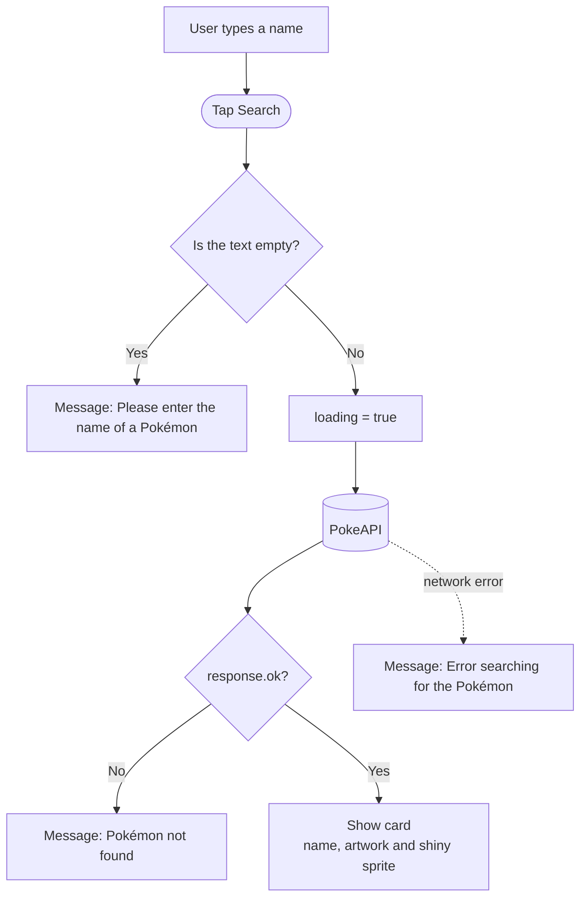

<div align="center">

# Clase2Pokemon

**A React Native Pokémon search app that consumes PokeAPI and shows the official artwork and the shiny sprite.**


</div>

---

## Table of Contents

- [About](#about)
- [At a Glance](#at-a-glance)
- [Features](#features)
- [Concepts Applied](#concepts-applied)
- [Search Flow](#search-flow)
- [How to Run](#how-to-run)
- [Example](#example)
- [Project Structure](#project-structure)
- [Requirements](#requirements)
- [Tech Stack](#tech-stack)

---

## About

This project was developed for the **Mobile App Development** course of my **Systems Engineering** degree. It was my first mobile app that consumes a web service: the user types the name of a Pokémon and the app requests its data from [PokeAPI](https://pokeapi.co/).

> [!NOTE]
> The application's interface text is in Spanish. The texts in this document are shown translated into English.

---

## At a Glance

| | |
|---|---|
| **Type** | Mobile application (Android and iOS) |
| **Framework** | React Native 0.88 with React 19 |
| **API** | `https://pokeapi.co/api/v2/pokemon/{name}` |
| **Difficulty** | ★★☆ |
| **Key concepts** | `fetch`, `async`/`await`, `try`/`catch`, `ActivityIndicator`, `Image` |

---

## Features

- **Search by name:** the name is converted to lower case before calling the API.
- **Loading indicator:** an `ActivityIndicator` is shown while the request is in progress.
- **Pokémon card:** name in capital letters and the official artwork (or the default sprite when there is no artwork).
- **Shiny sprite:** a second image with the shiny version of the Pokémon.
- **Messages:** a prompt when the search box is empty, *Pokémon not found* when the name does not exist, and an error message when the request fails.

---

## Concepts Applied

- **State with hooks:** `useState` for the search text, the API data, the loading flag and the error message.
- **Asynchronous requests:** `fetch` with `async` / `await` and `response.json()`.
- **Error handling:** `response.ok` to detect a missing Pokémon and `try` / `catch` for network errors.
- **Optional chaining:** `data?.sprites?.other?.['official-artwork']?.front_default` safely reads nested data.
- **Conditional rendering:** `&&` and the ternary operator show the loader, the error and the card only when needed.
- **Remote images:** `Image` with `source={{ uri }}` and `resizeMode="contain"`.
- **Touchable components:** `TouchableOpacity` as a custom button.

---

## Search Flow



---

## How to Run

```bash
cd Clase2Pokemon
npm install
npm start          # terminal 1: starts the Metro bundler
npm run android    # terminal 2: builds and opens the app on Android
```

To run it on iOS (macOS only):

```bash
bundle install
cd ios && bundle exec pod install && cd ..
npm run ios
```

> [!TIP]
> The emulator or device needs an internet connection to reach PokeAPI.

---

## Example

<details>
<summary>Show an example search</summary>

```text
Pokémon Search

[ charizard                ]
[ Search ]

┌──────────────────────────┐
│        CHARIZARD         │
│    (official artwork)    │
│                          │
│          Shiny           │
│     (shiny sprite)       │
└──────────────────────────┘
```

</details>

---

## Project Structure

```text
Clase2Pokemon/
├── App.tsx              # Search screen (state, API request and card)
├── index.js             # Registers the root component
├── app.json             # App name
├── package.json         # Dependencies and npm scripts
├── android/             # Native Android project
├── ios/                 # Native iOS project
└── __tests__/           # Default render test
```

---

## Requirements

- [Node.js](https://nodejs.org/) 22.11 or later and npm
- Android Studio with the Android SDK and an emulator, and JDK 17
- For iOS: macOS with Xcode and CocoaPods
- See the official [React Native environment setup guide](https://reactnative.dev/docs/set-up-your-environment)

Clone the repository:

```bash
git clone https://github.com/XanderiukS/Mobile-App-Development-University.git
```

---

## Tech Stack

| Category | Technology |
|---|---|
| Framework | React Native 0.88 |
| UI library | React 19 |
| Language | TypeScript |
| API | PokeAPI |
| Platforms | Android and iOS |
| Version control | Git and GitHub |

---

<div align="center">

Part of [Mobile App Development – University Projects](../README.md)

**Alexander Oliva** · [GitHub](https://github.com/XanderiukS) · [LinkedIn](https://www.linkedin.com/in/alexander-oliva-estrada)

</div>
