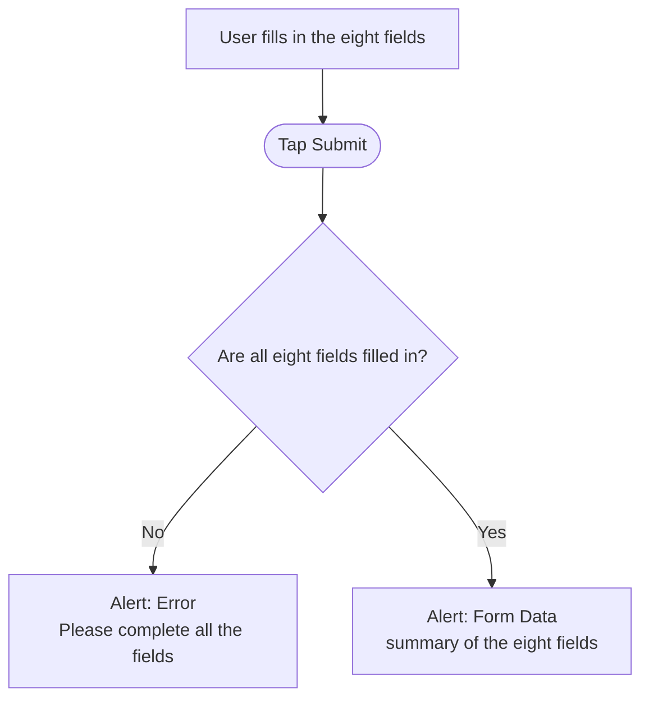

<div align="center">

# EightCharactersMobileApp

**A React Native user registration form with eight fields, keyboard handling and input validation.**


</div>

---

## Table of Contents

- [About](#about)
- [At a Glance](#at-a-glance)
- [Features](#features)
- [Concepts Applied](#concepts-applied)
- [Form Flow](#form-flow)
- [How to Run](#how-to-run)
- [Example](#example)
- [Project Structure](#project-structure)
- [Requirements](#requirements)
- [Tech Stack](#tech-stack)

---

## About

This project was developed for the **Mobile App Development** course of my **Systems Engineering** degree. It extends my first form to **eight fields** (first name, last name, age, phone, email, address, DPI and nationality) and improves the experience on a real device: each field opens the right keyboard and the form moves up when the keyboard appears.

> [!NOTE]
> The application's interface text is in Spanish. The texts in this document are shown translated into English.

---

## At a Glance

| | |
|---|---|
| **Type** | Mobile application (Android and iOS) |
| **Framework** | React Native 0.87 with React 19 |
| **Main component** | `FormularioUsuario` (`App.tsx`) |
| **Difficulty** | ★☆☆ |
| **Key concepts** | `useState`, `KeyboardAvoidingView`, keyboard types, validation |

---

## Features

- **Eight input fields:** first name, last name, age, phone, email, address, DPI and nationality.
- **Keyboard per field:**

  | Field | Keyboard |
  |---|---|
  | Age, DPI | `numeric` |
  | Phone | `phone-pad` |
  | Email | `email-address`, without automatic capitalization |
  | Other fields | Default |

- **Keyboard avoidance:** the form moves up so the focused input stays visible, with a different behavior on iOS and Android.
- **Validation:** if any field is empty, an error alert asks the user to complete the form.
- **Data summary:** when every field is filled in, an alert shows all the entered data.

---

## Concepts Applied

- **State with hooks:** eight `useState` hooks, one per field.
- **Controlled inputs:** `value` and `onChangeText` on every `TextInput`.
- **Platform-specific code:** `Platform.OS` selects `padding` on iOS and `height` on Android for `KeyboardAvoidingView`.
- **Scroll behavior:** `keyboardShouldPersistTaps="handled"` lets the user tap the button while the keyboard is open.
- **Input configuration:** `keyboardType` and `autoCapitalize`.
- **Validation:** a single condition checks that none of the eight fields is empty.
- **Native alerts:** `Alert.alert` with a multi-line message built with a template literal.

---

## Form Flow



---

## How to Run

```bash
cd EightCharactersMobileApp
npm install
npm start          # terminal 1: starts the Metro bundler
npm run android    # terminal 2: builds and opens the app on Android
```

To run it on iOS (macOS only):

```bash
bundle install
cd ios && bundle exec pod install && cd ..
npm run ios
```

> [!TIP]
> Start an Android emulator from Android Studio, or connect a device with USB debugging enabled, before running `npm run android`.

---

## Example

<details>
<summary>Show an example submission</summary>

```text
┌──────────────────────────────────────┐
│ Form Data                            │
│ First name: Alexander                │
│ Last name: Oliva                     │
│ Age: 22                              │
│ Phone: 55551234                      │
│ Email: alexander@example.com         │
│ Address: Zone 1, Guatemala City      │
│ DPI: 1234567890101                   │
│ Nationality: Guatemalan              │
└──────────────────────────────────────┘
```

</details>

---

## Project Structure

```text
EightCharactersMobileApp/
├── App.tsx              # Form component (state, validation and layout)
├── index.js             # Registers the root component
├── app.json             # App name
├── package.json         # Dependencies and npm scripts
├── android/             # Native Android project
├── ios/                 # Native iOS project
└── __tests__/           # Default render test
```

---

## Requirements

- [Node.js](https://nodejs.org/) 22.11 or later and npm
- Android Studio with the Android SDK and an emulator, and JDK 17
- For iOS: macOS with Xcode and CocoaPods
- See the official [React Native environment setup guide](https://reactnative.dev/docs/set-up-your-environment)

Clone the repository:

```bash
git clone https://github.com/XanderiukS/Mobile-App-Development-University.git
```

---

## Tech Stack

| Category | Technology |
|---|---|
| Framework | React Native 0.87 |
| UI library | React 19 |
| Language | TypeScript |
| Platforms | Android and iOS |
| Version control | Git and GitHub |

---

<div align="center">

Part of [Mobile App Development – University Projects](../README.md)

**Alexander Oliva** · [GitHub](https://github.com/XanderiukS) · [LinkedIn](https://www.linkedin.com/in/alexander-oliva-estrada)

</div>
