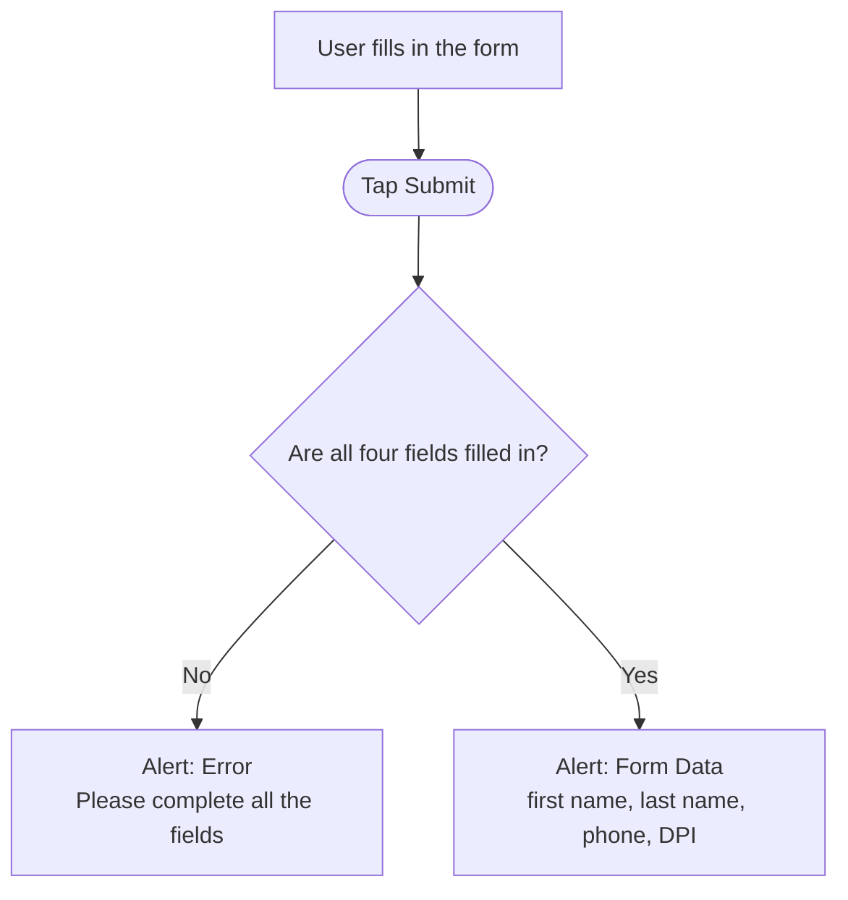

<div align="center">

# FirstMobileApp

**My first React Native application: a user registration form with input validation.**


</div>

---

## Table of Contents

- [About](#about)
- [At a Glance](#at-a-glance)
- [Features](#features)
- [Concepts Applied](#concepts-applied)
- [Form Flow](#form-flow)
- [How to Run](#how-to-run)
- [Example](#example)
- [Project Structure](#project-structure)
- [Requirements](#requirements)
- [Tech Stack](#tech-stack)

---

## About

This project was developed for the **Mobile App Development** course of my **Systems Engineering** degree. It was my first mobile application: a single screen with a form that asks for the user's first name, last name, phone number and DPI (Guatemalan ID number), checks that every field is filled in and shows the entered data.

The goal was to learn the basics of React Native: functional components, state, text inputs and native alerts.

> [!NOTE]
> The application's interface text is in Spanish. The texts in this document are shown translated into English.

---

## At a Glance

| | |
|---|---|
| **Type** | Mobile application (Android and iOS) |
| **Framework** | React Native 0.87 with React 19 |
| **Main component** | `FormularioUsuario` (`App.tsx`) |
| **Difficulty** | ★☆☆ |
| **Key concepts** | `useState`, `TextInput`, `Button`, `Alert`, `StyleSheet` |

---

## Features

- **Four input fields:** first name, last name, phone and DPI.
- **Numeric keyboard** for the phone and DPI fields (`keyboardType="phone-pad"`).
- **Validation:** if any field is empty, an error alert asks the user to complete the form.
- **Data summary:** when every field is filled in, an alert shows all the entered data.
- **Scrollable layout** with `ScrollView`.

---

## Concepts Applied

- **Functional components:** the whole screen is the `FormularioUsuario` component.
- **State with hooks:** one `useState` per field (`nombre`, `apellido`, `telefono`, `dpi`).
- **Controlled inputs:** each `TextInput` uses `value` and `onChangeText`.
- **Event handling:** the *Submit* button calls `handleSumbit` through `onPress`.
- **Conditional logic:** a logical OR (`||`) check detects empty fields.
- **Native alerts:** `Alert.alert` shows the error or the summary.
- **Styles:** `StyleSheet.create` for the container, labels and inputs.

---

## Form Flow



---

## How to Run

```bash
cd FirstMobileApp
npm install
npm start          # terminal 1: starts the Metro bundler
npm run android    # terminal 2: builds and opens the app on Android
```

To run it on iOS (macOS only):

```bash
bundle install
cd ios && bundle exec pod install && cd ..
npm run ios
```

> [!TIP]
> Start an Android emulator from Android Studio, or connect a device with USB debugging enabled, before running `npm run android`.

---

## Example

<details>
<summary>Show example alerts</summary>

```text
First name:  Alexander
Last name:   Oliva
Phone:       55551234
DPI:         1234567890101
[ Submit ]

┌─────────────────────────────┐
│ Form Data                   │
│ First name: Alexander       │
│ Last name: Oliva            │
│ Phone: 55551234             │
│ DPI: 1234567890101          │
└─────────────────────────────┘
```

With an empty field:

```text
┌──────────────────────────────────┐
│ Error                            │
│ Please complete all the fields   │
└──────────────────────────────────┘
```

</details>

---

## Project Structure

```text
FirstMobileApp/
├── App.tsx              # Form component (state, validation and layout)
├── index.js             # Registers the root component
├── app.json             # App name
├── package.json         # Dependencies and npm scripts
├── android/             # Native Android project
├── ios/                 # Native iOS project
└── __tests__/           # Default render test
```

---

## Requirements

- [Node.js](https://nodejs.org/) 22.11 or later and npm
- Android Studio with the Android SDK and an emulator, and JDK 17
- For iOS: macOS with Xcode and CocoaPods
- See the official [React Native environment setup guide](https://reactnative.dev/docs/set-up-your-environment)

Clone the repository:

```bash
git clone https://github.com/XanderiukS/Mobile-App-Development-University.git
```

---

## Tech Stack

| Category | Technology |
|---|---|
| Framework | React Native 0.87 |
| UI library | React 19 |
| Language | TypeScript |
| Platforms | Android and iOS |
| Version control | Git and GitHub |

---

<div align="center">

Part of [Mobile App Development – University Projects](../README.md)

**Alexander Oliva** · [GitHub](https://github.com/XanderiukS) · [LinkedIn](https://www.linkedin.com/in/alexander-oliva-estrada)

</div>
