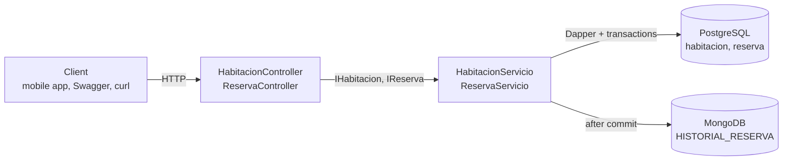
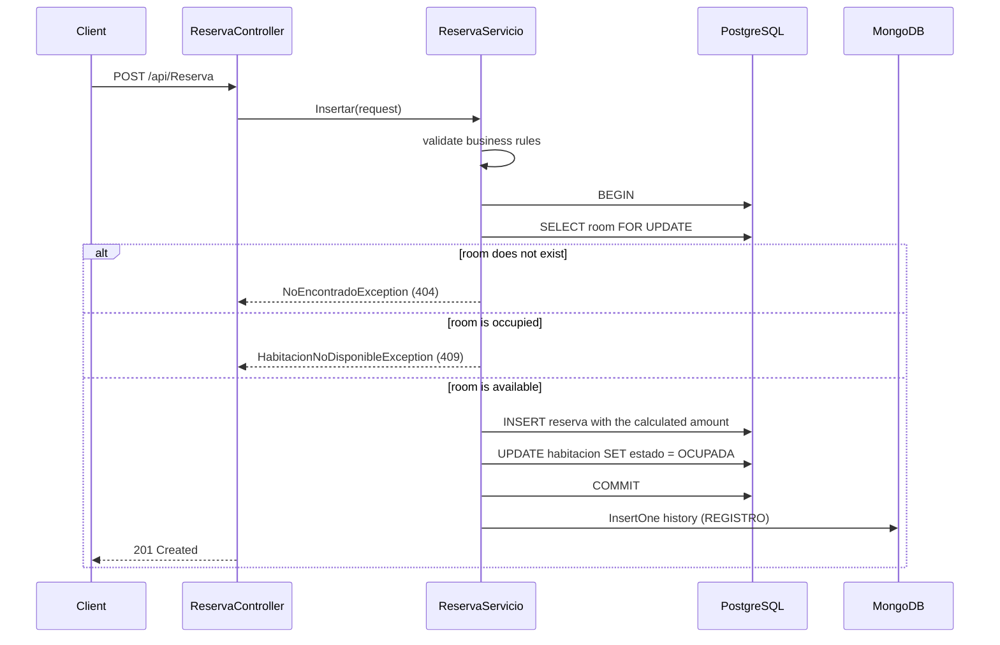
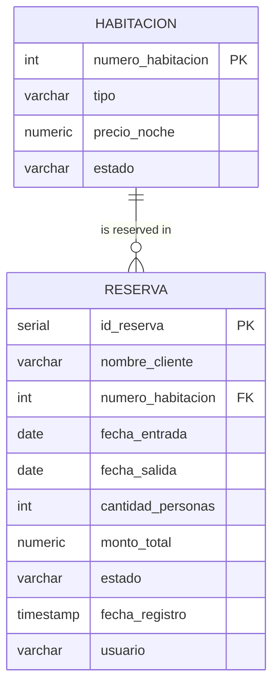

<div align="center">

# HotelAPI

**An ASP.NET Core REST API for hotel reservations, with room availability control, transactions and a reservation history in MongoDB.**


</div>

---

## Table of Contents

- [About](#about)
- [At a Glance](#at-a-glance)
- [Features](#features)
- [Concepts Applied](#concepts-applied)
- [Architecture](#architecture)
- [Reservation Flow](#reservation-flow)
- [Data Model](#data-model)
- [Endpoints](#endpoints)
- [How to Run](#how-to-run)
- [Example Requests](#example-requests)
- [Project Structure](#project-structure)
- [Requirements](#requirements)
- [Tech Stack](#tech-stack)

---

## About

This project was developed for the **Mobile App Development** course of my **Systems Engineering** degree as a back end that mobile clients can consume. It manages the rooms and reservations of a hotel: when a room is reserved it becomes **occupied**, the total amount is calculated from the number of nights, and every operation is recorded in a **history collection in MongoDB**.

The focus of the project is data consistency: every write runs inside a **PostgreSQL transaction** and locks the affected rows, so two clients cannot reserve the same room at the same time.

> [!NOTE]
> The API's response messages are in Spanish. The messages in this document are shown translated into English. JSON property names and stored values are kept as they appear in the code.

---

## At a Glance

| | |
|---|---|
| **Type** | REST API |
| **Framework** | ASP.NET Core (.NET 9) |
| **Databases** | PostgreSQL (`HOTEL`) and MongoDB (`HOTEL.HISTORIAL_RESERVA`) |
| **Data access** | Dapper and the MongoDB .NET Driver |
| **Difficulty** | ★★★ |
| **Key concepts** | Transactions, `SELECT ... FOR UPDATE`, custom exceptions, business rules |

---

## Features

- **Rooms:** list of rooms with type, price per night and status (`DISPONIBLE` = available, `OCUPADA` = occupied).
- **Reservations:** list, create, update and delete.
- **Availability control:** a reservation can only be made on an available room. Creating a reservation marks the room as occupied, and deleting it releases the room.
- **Room change:** when a reservation is moved to another room, the previous room is released and the new one is occupied.
- **Amount calculation:** `total = nights × price per night`, where nights are the days between check-in and check-out.
- **Business rules:** client name and user are required, check-out must be after check-in, and the number of guests must be greater than zero.
- **History:** each registration, modification and deletion inserts a document in MongoDB with the operation type, description and user.
- **Interactive documentation** with OpenAPI and Swagger UI in development.

---

## Concepts Applied

- **Layered architecture:** `HotelApi` (controllers), `Coree` (interfaces, services and exceptions) and `Modelo` (entities).
- **Database transactions:** `BeginTransactionAsync`, commit and rollback around every write.
- **Row locking:** `SELECT ... FOR UPDATE` locks the room and the reservation while they are being modified.
- **Custom exceptions:** `ValidacionException`, `NoEncontradoException` and `HabitacionNoDisponibleException`, mapped to `400`, `404` and `409` with a C# `switch` expression.
- **Request models:** `MReservaRequest` separates the input data from the stored `MReserva`.
- **`DateOnly`:** check-in and check-out dates without a time component.
- **Resilient logging:** the MongoDB history is written after the commit, so a MongoDB failure does not undo the reservation.
- **Database script:** `Database/hotel.sql` creates the tables with constraints and six sample rooms.

---

## Architecture



---

## Reservation Flow



---

## Data Model



<details>
<summary>Show the sample rooms and the MongoDB history document</summary>

| Room | Type | Price per night |
|:---:|---|---:|
| 101 | SENCILLA (single) | 250.00 |
| 102 | SENCILLA (single) | 250.00 |
| 103 | DOBLE (double) | 400.00 |
| 201 | DOBLE (double) | 420.00 |
| 202 | SUITE | 750.00 |
| 301 | SUITE | 950.00 |

**`HISTORIAL_RESERVA` document (`MReservaHistorialMongo`):** `IdReserva`, `NumeroHabitacion`, `Estado`, `TipoOperacion` (`REGISTRO`, `MODIFICACION` or `ELIMINACION`), `Descripcion`, `Usuario` and `FechaOperacion`.

</details>

---

## Endpoints

| Method | Route | Description |
|---|---|---|
| `GET` | `/api/Habitacion` | Lists all rooms |
| `GET` | `/api/Reserva` | Lists all reservations |
| `POST` | `/api/Reserva` | Creates a reservation and occupies the room |
| `PUT` | `/api/Reserva/{id}` | Updates a reservation (dates, guests, client or room) |
| `DELETE` | `/api/Reserva/{id}?usuario={user}` | Deletes a reservation and releases the room |

---

## How to Run

**1. Create the PostgreSQL database** and run the script:

```bash
psql -U postgres -c "CREATE DATABASE \"HOTEL\";"
psql -U postgres -d HOTEL -f Database/hotel.sql
```

**2. Start MongoDB** on `localhost:27017`.

**3. Configure the connection** in `HotelApi/appsettings.json` by replacing `YOUR_PASSWORD` with your PostgreSQL password.

**4. Run the API:**

```bash
cd HotelAPI
dotnet run --project HotelApi
```

Open `http://localhost:5129/swagger` to test the endpoints.

> [!TIP]
> You can also open `HotelApi.sln` in Visual Studio 2022 and press <kbd>F5</kbd>.

---

## Example Requests

<details>
<summary>Show request and response examples</summary>

**`POST /api/Reserva`** (3 nights in room 202 at 750.00 per night)

```json
{
  "nombreCliente": "Ana Morales",
  "numeroHabitacion": 202,
  "fechaEntrada": "2026-12-20",
  "fechaSalida": "2026-12-23",
  "cantidadPersonas": 2,
  "usuario": "recepcion"
}
```

**`201 Created`** — the reservation is stored with `montoTotal: 2250.00` and room 202 changes to `OCUPADA`.

**Reserving the same room again (`409 Conflict`):**

```json
{ "mensaje": "Room 202 is not available." }
```

**Invalid dates (`400 Bad Request`):**

```json
{ "mensaje": "The check-out date must be after the check-in date." }
```

**`DELETE /api/Reserva/1?usuario=recepcion`**

```json
{ "mensaje": "Reservation deleted successfully." }
```

</details>

---

## Project Structure

```text
HotelAPI/
├── HotelApi.sln                        # Visual Studio solution
├── Database/
│   └── hotel.sql                       # Tables, constraints and sample rooms
├── HotelApi/                           # Web API project
│   ├── Controllers/
│   │   ├── HabitacionController.cs     # Room endpoints
│   │   └── ReservaController.cs        # Reservation endpoints and error mapping
│   ├── Program.cs                      # Dependency injection and Swagger
│   └── appsettings.json                # Connection strings
├── Coree/                              # Business logic
│   ├── Interfaz/                       # IHabitacion, IReserva
│   └── Servicio/
│       ├── HabitacionServicio.cs       # Room queries
│       ├── ReservaServicio.cs          # Transactions, rules and history
│       └── HotelExcepciones.cs         # Custom exceptions
└── Modelo/                             # Entities
    └── Modelos/
        ├── MHabitacion.cs              # Room
        ├── MReserva.cs                 # Reservation and request model
        └── MReservaHistorialMongo.cs   # History document
```

---

## Requirements

- [.NET 9 SDK](https://dotnet.microsoft.com/download/dotnet/9.0)
- [PostgreSQL](https://www.postgresql.org/download/)
- [MongoDB Community Server](https://www.mongodb.com/try/download/community)
- Visual Studio 2022 or Visual Studio Code (optional)

Clone the repository:

```bash
git clone https://github.com/XanderiukS/Mobile-App-Development-University.git
```

---

## Tech Stack

| Category | Technology |
|---|---|
| Framework | ASP.NET Core (.NET 9) |
| Language | C# |
| Relational database | PostgreSQL with Npgsql and Dapper |
| Document database | MongoDB with the MongoDB .NET Driver |
| API documentation | OpenAPI and Swagger UI |
| Version control | Git and GitHub |

---

<div align="center">

Part of [Mobile App Development – University Projects](../README.md)

**Alexander Oliva** · [GitHub](https://github.com/XanderiukS) · [LinkedIn](https://www.linkedin.com/in/alexander-oliva-estrada)

</div>
