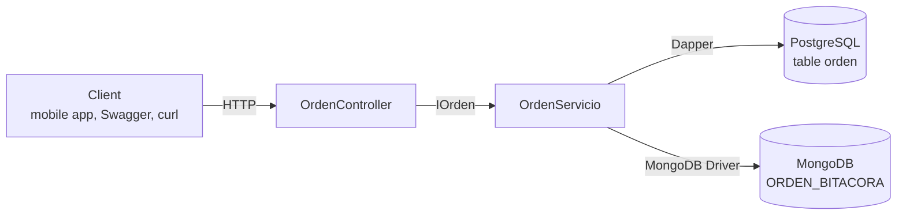
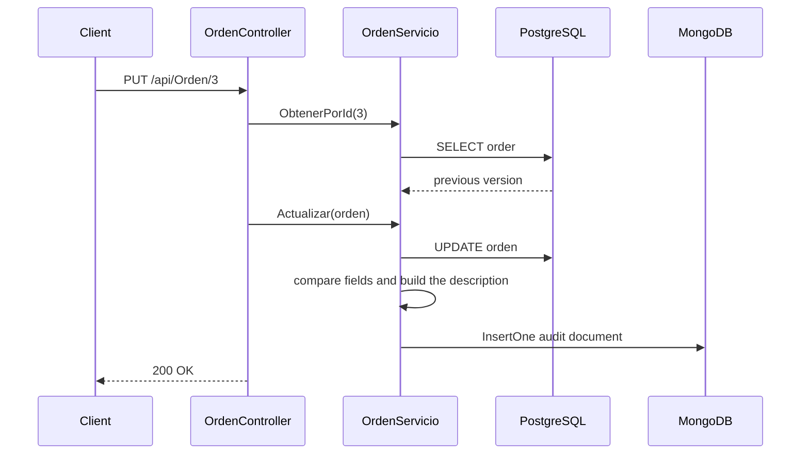
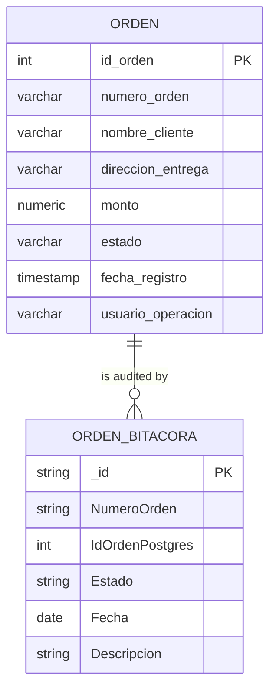

<div align="center">

# Ordenes_API

**An ASP.NET Core REST API to manage delivery orders, with PostgreSQL storage and an audit log in MongoDB.**


</div>

---

## Table of Contents

- [About](#about)
- [At a Glance](#at-a-glance)
- [Features](#features)
- [Concepts Applied](#concepts-applied)
- [Architecture](#architecture)
- [Data Model](#data-model)
- [Endpoints](#endpoints)
- [How to Run](#how-to-run)
- [Example Requests](#example-requests)
- [Project Structure](#project-structure)
- [Requirements](#requirements)
- [Tech Stack](#tech-stack)

---

## About

This project was developed for the **Mobile App Development** course of my **Systems Engineering** degree as a back end that mobile clients can consume. It manages delivery orders: each order is stored in **PostgreSQL**, and every creation and modification is also written to an **audit log in MongoDB** that describes exactly which fields changed.

> [!NOTE]
> The API's response messages are in Spanish. The messages in this document are shown translated into English. JSON property names are kept as they appear in the code.

---

## At a Glance

| | |
|---|---|
| **Type** | REST API |
| **Framework** | ASP.NET Core (.NET 9) |
| **Databases** | PostgreSQL (`SISTEMA_ORDENES`) and MongoDB (`SISTEMA_ORDENES.ORDEN_BITACORA`) |
| **Data access** | Dapper and the MongoDB .NET Driver |
| **Difficulty** | ★★☆ |
| **Key concepts** | Layered architecture, dependency injection, CRUD, audit log |

---

## Features

- **Full CRUD** for orders: list, get by ID, create, update and delete.
- **Input validation:** order number, client name, delivery address and operation user are required, and the amount must be greater than zero.
- **Audit log:** each creation and update inserts a document in MongoDB. Documents are only inserted, never modified, so the full history of each order is kept.
- **Change detection:** on update, the service compares the previous and new versions and records the changed fields (status, amount, client, address and order number).
- **Interactive documentation** with OpenAPI and Swagger UI in development.

---

## Concepts Applied

- **Layered architecture:** `Ordenes_API` (controllers), `Core` (interfaces and services) and `Modelo` (entities), as separate projects.
- **Dependency injection:** `IOrden` is registered with `OrdenServicio`, and the PostgreSQL data source and the MongoDB client are registered as singletons.
- **Dapper:** parameterized SQL queries mapped to `MOrden`.
- **MongoDB:** `InsertOneAsync` on the `ORDEN_BITACORA` collection with the `MOrdenMongo` document.
- **HTTP status codes:** `200 OK`, `400 Bad Request`, `404 Not Found` and `500 Internal Server Error` with a JSON message.
- **Asynchronous programming:** `async` / `await` in controllers and services.
- **Configuration:** connection strings read from `appsettings.json`.

---

## Architecture



**Flow of `PUT /api/Orden/{id}`:**



---

## Data Model



---

## Endpoints

| Method | Route | Description | Writes to |
|---|---|---|---|
| `GET` | `/api/Orden` | Lists all orders | — |
| `GET` | `/api/Orden/{id}` | Gets an order by its PostgreSQL ID | — |
| `POST` | `/api/Orden` | Creates an order | PostgreSQL and MongoDB |
| `PUT` | `/api/Orden/{id}` | Updates an order | PostgreSQL and MongoDB |
| `DELETE` | `/api/Orden/{id}` | Deletes an order | PostgreSQL |

---

## How to Run

**1. Create the PostgreSQL database** and run the script, which creates the `orden` table, an index and two sample orders:

```bash
psql -U postgres -c "CREATE DATABASE \"SISTEMA_ORDENES\";"
psql -U postgres -d SISTEMA_ORDENES -f Database/script_postgresql.sql
```

**2. Start MongoDB** on `localhost:27017`. The database and the collection are created automatically on the first insert.

**3. Configure the connection** in `Ordenes_API/appsettings.json` by replacing `YOUR_PASSWORD` with your PostgreSQL password:

```json
"ConnectionStrings": {
  "DefaultConnection": "Host=localhost;Port=5432;Database=SISTEMA_ORDENES;Username=postgres;Password=YOUR_PASSWORD",
  "MongoDB": "mongodb://localhost:27017"
}
```

**4. Run the API:**

```bash
cd Ordenes_API
dotnet run --project Ordenes_API
```

Open `http://localhost:5180/swagger` to test the endpoints.

> [!TIP]
> You can also open `Ordenes_API.sln` in Visual Studio 2022 and press <kbd>F5</kbd>.

---

## Example Requests

<details>
<summary>Show request and response examples</summary>

**`POST /api/Orden`**

```json
{
  "numeroOrden": "ORD-0003",
  "nombreCliente": "Carlos Ramirez",
  "direccionEntrega": "Boulevard Los Proceres 12-34, Zone 10",
  "monto": 450.75,
  "estado": "REGISTRADA",
  "usuarioOperacion": "admin"
}
```

```json
{
  "mensaje": "Order registered successfully in PostgreSQL and in the MongoDB audit log.",
  "idOrden": 3
}
```

**`PUT /api/Orden/3`** changing the status and the amount creates this audit document:

```json
{
  "NumeroOrden": "ORD-0003",
  "IdOrdenPostgres": 3,
  "Estado": "ENTREGADA",
  "Descripcion": "Order modified by 'supervisor' on 2026-12-01 10:30:00. Changes -> status: 'REGISTRADA' -> 'ENTREGADA'; amount: 450.75 -> 600.00."
}
```

**Validation error (`400 Bad Request`):**

```json
{ "mensaje": "The amount must be greater than zero." }
```

**With curl:**

```bash
curl http://localhost:5180/api/Orden
curl -X DELETE http://localhost:5180/api/Orden/2
```

</details>

---

## Project Structure

```text
Ordenes_API/
├── Ordenes_API.sln                 # Visual Studio solution
├── Database/
│   └── script_postgresql.sql       # Table, index and sample data
├── Ordenes_API/                    # Web API project
│   ├── Controllers/
│   │   └── OrdenController.cs      # Endpoints and validation
│   ├── Program.cs                  # Dependency injection and Swagger
│   └── appsettings.json            # Connection strings
├── Core/                           # Business logic
│   ├── Interfaz/
│   │   └── IOrden.cs               # Service contract
│   └── Servicio/
│       └── OrdenServicio.cs        # PostgreSQL and MongoDB operations
└── Modelo/                         # Entities
    └── Modelos/
        ├── MOrden.cs               # Order (PostgreSQL)
        └── MOrdenMongo.cs          # Audit document (MongoDB)
```

---

## Requirements

- [.NET 9 SDK](https://dotnet.microsoft.com/download/dotnet/9.0)
- [PostgreSQL](https://www.postgresql.org/download/)
- [MongoDB Community Server](https://www.mongodb.com/try/download/community) (optionally MongoDB Compass to inspect the audit log)
- Visual Studio 2022 or Visual Studio Code (optional)

Clone the repository:

```bash
git clone https://github.com/XanderiukS/Mobile-App-Development-University.git
```

---

## Tech Stack

| Category | Technology |
|---|---|
| Framework | ASP.NET Core (.NET 9) |
| Language | C# |
| Relational database | PostgreSQL with Npgsql and Dapper |
| Document database | MongoDB with the MongoDB .NET Driver |
| API documentation | OpenAPI and Swagger UI |
| Version control | Git and GitHub |

---

<div align="center">

Part of [Mobile App Development – University Projects](../README.md)

**Alexander Oliva** · [GitHub](https://github.com/XanderiukS) · [LinkedIn](https://www.linkedin.com/in/alexander-oliva-estrada)

</div>
