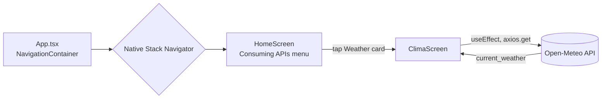

<div align="center">

# ProjectMovil

**A React Native app with screen navigation and a weather screen that consumes the Open-Meteo API.**


</div>

---

## Table of Contents

- [About](#about)
- [At a Glance](#at-a-glance)
- [Features](#features)
- [Concepts Applied](#concepts-applied)
- [Navigation](#navigation)
- [How to Run](#how-to-run)
- [Example](#example)
- [Project Structure](#project-structure)
- [Requirements](#requirements)
- [Tech Stack](#tech-stack)

---

## About

This project was developed for the **Mobile App Development** course of my **Systems Engineering** degree. It introduces navigation between screens: a home menu called *Consuming APIs* leads to a weather screen that shows the current temperature and wind speed from the [Open-Meteo](https://open-meteo.com/) API.

> [!NOTE]
> The application's interface text is in Spanish. The texts in this document are shown translated into English.

---

## At a Glance

| | |
|---|---|
| **Type** | Mobile application (Android and iOS) |
| **Framework** | React Native 0.88 with React Navigation 7 |
| **Screens** | `HomeScreen`, `ClimaScreen` |
| **API** | Open-Meteo current weather |
| **Difficulty** | ★★☆ |
| **Key concepts** | Native stack navigation, `axios`, `useEffect`, dark theme |

---

## Features

- **Home menu:** cards with a title and a short description for each section.
- **Navigation:** tapping the *Weather* card opens the weather screen.
- **Current weather:** temperature in °C and wind speed in km/h, requested when the screen opens (coordinates 14, -90, Guatemala).
- **Loading text** while the weather data arrives.
- **Dark design** with turquoise accents.

---

## Concepts Applied

- **React Navigation:** `NavigationContainer` and `createNativeStackNavigator` with two screens and the header hidden.
- **Navigation prop:** `navigation.navigate('Clima')` from the home screen.
- **HTTP requests with axios:** `axios.get` with `.then` and `.catch`.
- **Side effects:** `useEffect` with an empty dependency array to request the data once when the screen mounts.
- **Conditional rendering:** a ternary shows the data or the loading text.
- **Project organization:** screens live in the `pantallas/` folder, separate from `App.tsx`.

---

## Navigation



---

## How to Run

```bash
cd ProjectMovil
npm install
npm start          # terminal 1: starts the Metro bundler
npm run android    # terminal 2: builds and opens the app on Android
```

To run it on iOS (macOS only):

```bash
bundle install
cd ios && bundle exec pod install && cd ..
npm run ios
```

> [!TIP]
> The emulator or device needs an internet connection to reach the Open-Meteo API.

---

## Example

<details>
<summary>Show the screens</summary>

```text
Home screen
  Consuming APIs
  ┌──────────────────────────────────────┐
  │ Weather                              │
  │ Check the current weather and        │
  │ forecast                             │
  └──────────────────────────────────────┘

Weather screen
  Current Weather
  ┌──────────────────────┐
  │ 22.4°C               │
  │ Wind: 8.3 km/h       │
  └──────────────────────┘
```

</details>

---

## Project Structure

```text
ProjectMovil/
├── App.tsx                  # Navigation container and stack
├── pantallas/
│   ├── HomeScreen.js        # Home menu
│   └── ClimaScreen.js       # Weather screen (Open-Meteo)
├── index.js                 # Registers the root component
├── app.json                 # App name
├── package.json             # Dependencies and npm scripts
├── android/                 # Native Android project
├── ios/                     # Native iOS project
└── __tests__/               # Default render test
```

---

## Requirements

- [Node.js](https://nodejs.org/) 22.11 or later and npm
- Android Studio with the Android SDK and an emulator, and JDK 17
- For iOS: macOS with Xcode and CocoaPods
- See the official [React Native environment setup guide](https://reactnative.dev/docs/set-up-your-environment)

Clone the repository:

```bash
git clone https://github.com/XanderiukS/Mobile-App-Development-University.git
```

---

## Tech Stack

| Category | Technology |
|---|---|
| Framework | React Native 0.88 |
| Navigation | React Navigation 7 (native stack) |
| HTTP client | Axios |
| Languages | TypeScript and JavaScript |
| API | Open-Meteo |
| Version control | Git and GitHub |

---

<div align="center">

Part of [Mobile App Development – University Projects](../README.md)

**Alexander Oliva** · [GitHub](https://github.com/XanderiukS) · [LinkedIn](https://www.linkedin.com/in/alexander-oliva-estrada)

</div>
