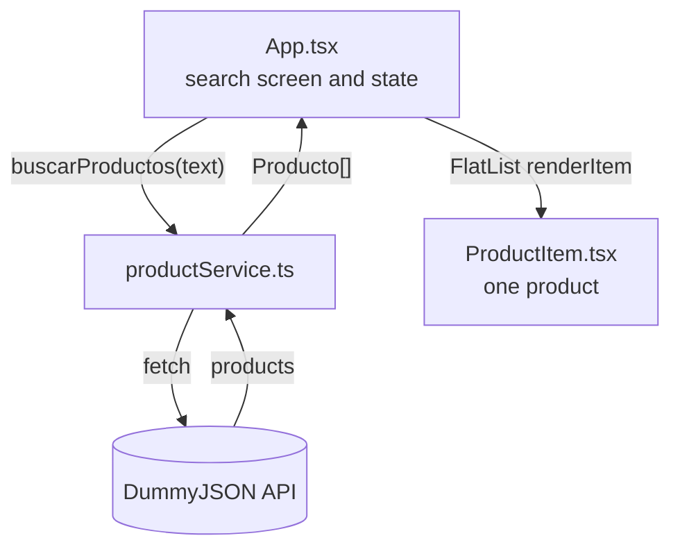
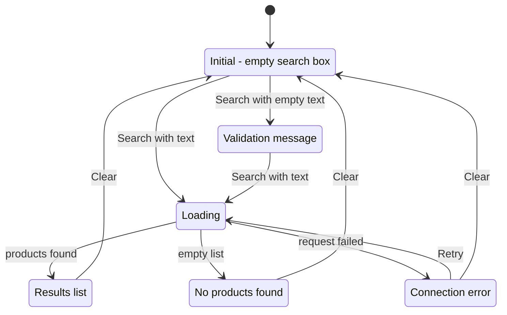

<div align="center">

# StoreXander

**A React Native product catalog with search, retry and clear actions, consuming the DummyJSON API.**


</div>

---

## Table of Contents

- [About](#about)
- [At a Glance](#at-a-glance)
- [Features](#features)
- [Concepts Applied](#concepts-applied)
- [Architecture](#architecture)
- [Screen States](#screen-states)
- [How to Run](#how-to-run)
- [Example](#example)
- [Project Structure](#project-structure)
- [Requirements](#requirements)
- [Tech Stack](#tech-stack)

---

## About

This project was developed for the **Mobile App Development** course of my **Systems Engineering** degree. It is the catalog of *StoreXander*, a store app where the user searches for products by name and gets a list with image, description, price, category and stock, obtained from the [DummyJSON](https://dummyjson.com/) products API.

It is the most complete mobile app of the course: the code is split into a screen, a reusable component and a typed service layer, and the screen handles every state of a search.

> [!NOTE]
> The application's interface text is in Spanish. The texts in this document are shown translated into English.

---

## At a Glance

| | |
|---|---|
| **Type** | Mobile application (Android and iOS) |
| **Framework** | React Native 0.88 with React 19 |
| **API** | `https://dummyjson.com/products/search?q={text}` |
| **Difficulty** | ★★☆ |
| **Key concepts** | `FlatList`, reusable components, service layer, TypeScript interfaces |

---

## Features

- **Product search:** from the *Search* button or the keyboard's search key.
- **Product list:** thumbnail, title, two-line description, price, category and stock.
- **Results counter:** shows how many products were found.
- **Validation:** a message appears when the user searches with an empty box.
- **Error handling:** a connection error message with a *Retry* button that repeats the last search.
- **Clear:** the *Clear* button resets the text, the results and the messages.
- **No results message** when the search returns an empty list.
- **Safe area support** for devices with notches.

---

## Concepts Applied

- **Separation of concerns:** UI in `App.tsx`, product rendering in `ProductItem`, and the HTTP request in `productService`.
- **TypeScript interfaces:** `Producto` types the API data, and `Props` types the component properties.
- **Asynchronous service:** `buscarProductos` uses `fetch`, `encodeURIComponent` and throws an error when the response is not OK.
- **State management:** separate `useState` hooks for the results, loading, error, validation message, whether a search was done and the last search.
- **Lists:** `FlatList` with `keyExtractor`, `renderItem` and `ListHeaderComponent`.
- **Pressable feedback:** `Pressable` with styles that change while pressed.
- **Keyboard control:** `Keyboard.dismiss()`, `onSubmitEditing` and `returnKeyType="search"`.
- **Safe areas:** `SafeAreaProvider` and `SafeAreaView` from `react-native-safe-area-context`.

---

## Architecture



---

## Screen States



---

## How to Run

```bash
cd StoreXander
npm install
npm start          # terminal 1: starts the Metro bundler
npm run android    # terminal 2: builds and opens the app on Android
```

To run it on iOS (macOS only):

```bash
bundle install
cd ios && bundle exec pod install && cd ..
npm run ios
```

> [!TIP]
> The emulator or device needs an internet connection to reach the DummyJSON API.

---

## Example

<details>
<summary>Show an example search</summary>

```text
StoreXander
Product Catalog

[ phone                    ]
[ Search ]  [ Clear ]

N product(s) found

┌───────────────────────────────────────────┐
│ (img)  Product title                      │
│        Product description, limited to    │
│        two lines...                       │
│        $549.99                            │
│        Category: smartphones · Stock: 25  │
└───────────────────────────────────────────┘
...
```

If the connection fails:

```text
Could not connect to the service. Check your internet connection.
Retry
```

</details>

---

## Project Structure

```text
StoreXander/
├── App.tsx                        # Search screen, state and result states
├── src/
│   ├── components/
│   │   └── ProductItem.tsx        # Product card
│   └── services/
│       └── productService.ts      # Producto interface and API request
├── index.js                       # Registers the root component
├── app.json                       # App name
├── package.json                   # Dependencies and npm scripts
├── android/                       # Native Android project
├── ios/                           # Native iOS project
└── __tests__/                     # Default render test
```

---

## Requirements

- [Node.js](https://nodejs.org/) 22.11 or later and npm
- Android Studio with the Android SDK and an emulator, and JDK 17
- For iOS: macOS with Xcode and CocoaPods
- See the official [React Native environment setup guide](https://reactnative.dev/docs/set-up-your-environment)

Clone the repository:

```bash
git clone https://github.com/XanderiukS/Mobile-App-Development-University.git
```

---

## Tech Stack

| Category | Technology |
|---|---|
| Framework | React Native 0.88 |
| UI library | React 19 |
| Language | TypeScript |
| Safe areas | react-native-safe-area-context |
| API | DummyJSON |
| Version control | Git and GitHub |

---

<div align="center">

Part of [Mobile App Development – University Projects](../README.md)

**Alexander Oliva** · [GitHub](https://github.com/XanderiukS) · [LinkedIn](https://www.linkedin.com/in/alexander-oliva-estrada)

</div>
